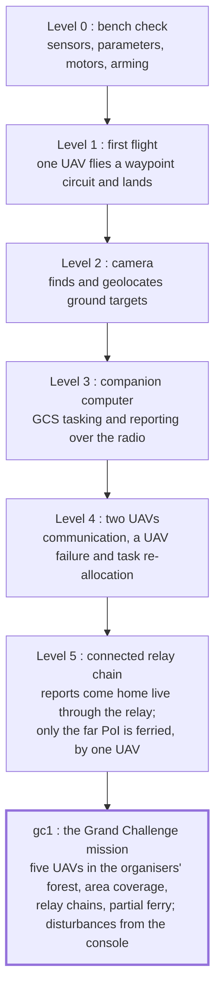

# UAV-X Stage 2 — Resilient BVLOS Swarm (Gazebo + ArduPilot + ROS 2)

A 3-D simulation of an autonomous UAV swarm searching a forest for Points of Interest and
getting its findings back to a Ground Control Station over a radio that cannot reach most of
the area, built on **real ArduPilot firmware (SITL), Gazebo Harmonic physics, and ROS 2
Humble**.

PUSHPAK Grand Challenge 2026 · Grand Challenge 1 — UAV-X: Resilient BVLOS Swarm · Team Sampati.

## The problem, in two numbers

The organisers fix a **100 m** inter-UAV radio range, and put a **500 m × 500 m** search area
**365 m** from the ground station. Those two numbers decide the whole design:

```
GCS mast → near tree line       112 m     1 relay for a live link
GCS mast → area centre          360 m     4 relays
GCS mast → far corner           664 m     7 relays
```

A live radio chain to the far corner is unaffordable at any fleet size the organisers would
accept — they explicitly discourage solving coverage by adding UAVs. So this swarm uses
**five UAVs and a partial data ferry**: four sweep a quadrant each while one holds the relay
chain that reaches into the forest, and a surveyor working beyond the chain buffers its
reports, flies to the nearest point inside the chain tip's range, hands them off to
multi-hop, and goes back to the lane it left. It gives up a round trip, not its progress.

## What this simulates

- **The drone** (`uavx_quad`): an ArduPilot quadcopter with IMU, GPS, barometer, magnetometer,
  a downward survey **camera** and a **rangefinder**, flown by real ArduPilot firmware over
  its ROS 2 (DDS) interface — exactly as a companion computer would on the real aircraft.
- **The organisers' world** (`forest_rescue`): their 500 m × 500 m forest search area on the
  world origin, 726 trees, perimeter posts every 20 m, and their ground station 365 m west
  with a 24-pad apron and a 10 m antenna mast. Generated from the coordinates in the
  simulation environment they shared, so the map is theirs and not an approximation of it.
- **The swarm**: the GCS splits the area into sectors and hands them out; each UAV plans its
  own lanes from its camera's real footprint, finds targets it was never told about,
  geolocates them, routes its reports home through whatever other UAVs can hear it, and
  decides for itself when to ferry, when to recharge and when to go home.
- **The radio**: log-distance path loss, foliage loss through the canopy, obstacle shadowing,
  the organisers' hard 100 m range, and injected outages, packet loss, bit errors and jamming.
- **Disturbances from the control console only**: UAV kills, low batteries, radio outages,
  packet loss, bit error rates, jamming and surprise emergency PoIs are injected live by the
  evaluator. The swarm code and the scenario files generate none, so the swarm never knows
  what is coming.
- **A drone POV window** showing every UAV's own camera live in one labelled grid.
- **A control console** (web page) the evaluator drives: a per-UAV kill switch, a bit error
  rate slider, comms degradation, new PoIs and the rest, all live, all logged as disturbances.

An independent referee scores every run against the challenge metrics and draws a map of
each mission.

## Quick start

You need WSL Ubuntu 22.04 with ArduPilot SITL, Gazebo Harmonic and ROS 2 Humble installed.
Full setup and prerequisites are in **[ros2/README.md](ros2/README.md)**.

**1. Get the code**

```bash
git clone https://github.com/haricha0425-cpu/UAV-X-Stage2_PUSHPAK.git
cd UAV-X-Stage2_PUSHPAK/ros2
```

**2. Build the workspace (only once)**

```bash
bash setup_ws.sh
```

**3. Run the Grand Challenge mission**

```bash
bash run_level.sh gc1
```

When it starts, open **http://localhost:8089** in a browser.

**4. Try a shorter run**

```bash
bash run_level.sh 5            # fast two-UAV relay check
bash run_level.sh 4 --gui      # an earlier level, with the Gazebo window open
```

**5. Run the tests without the simulator**

The offline test suite needs no simulator and no ROS 2 install. From the `ros2` folder:

```bash
cd src/uavx_swarm
python3 -m pytest -q test      # 128 tests, a few seconds
```

## The levels

The project builds up in levels. Each level adds one capability to the level before it, runs
from the `ros2` folder with `bash run_level.sh <name>` and ends with a PASS or FAIL verdict
from the referee. The referee judges by Gazebo ground truth and not by the swarm's own
opinion of itself.



Also available : `demo3d`, three UAVs in a 3-D town; disturbances are injected from the control console.

## Documentation

Start with **ros2/README.md**. The other two files each go deeper into one area.

**[ros2/README.md](ros2/README.md)** : setup, every level, the mission, the communication
strategy, the control panel and the files each run leaves behind.

**[ros2/docs/architecture.md](ros2/docs/architecture.md)** : what runs where, and how the
ArduPilot, Gazebo and ROS 2 parts connect.

**[ros2/docs/organiser_requirements.md](ros2/docs/organiser_requirements.md)** : all 48
answers from the organisers' technical session, each mapped to the code that satisfies it,
with the open gaps listed.

## Stage 1

The fast Python proof-of-concept simulator from Stage 1 lives in a separate repository:
[UAV_SWARM_PROJECT_S1](https://github.com/Ananymous08072008/UAV_SWARM_PROJECT_S1). It stays
the place for 100-seed sweeps; this repository is the high-fidelity counterpart, and the
relay placement, routing metric and energy rules here are ports of the algorithms proved
there.

## Licence

MIT — see [LICENSE](LICENSE). The `forest_rescue` map is generated from the *coordinates*
published in the organisers' simulation environment; no file from that repository is included
here.
