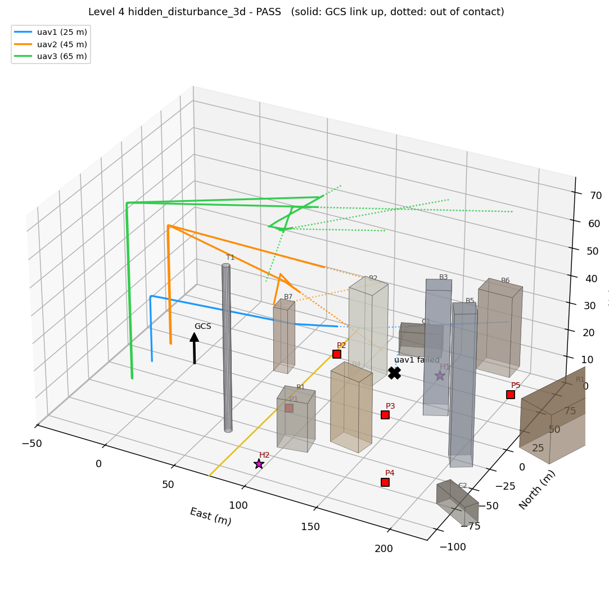
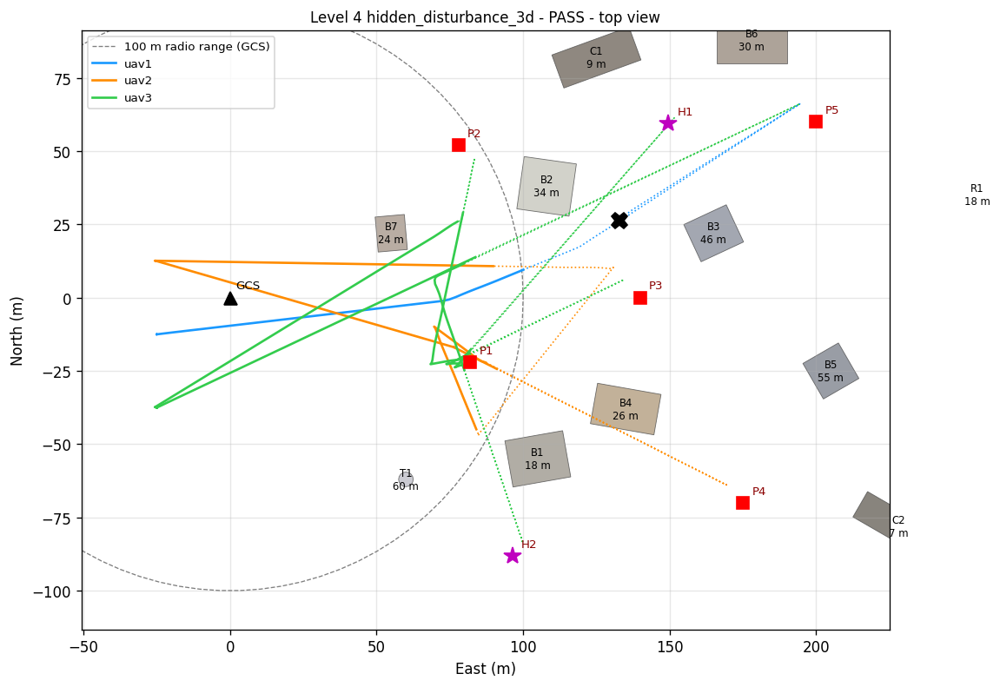

# UAV-X Stage 2: Gazebo + ArduPilot + ROS 2, level by level

This folder holds the high-fidelity stack for Stage 2, built up through the team's implementation plan:

```
LEVEL 0 bench hardware -> 1 one flying UAV -> 2 + camera -> 3 + companion computer
-> 4 two UAVs + communication -> 5 relay and multi-hop -> GC1 the organisers' mission
```

Levels 0 to 5 are implemented, plus `demo3d` and **`gc1`: the Grand Challenge mission on the
organisers' own map**. Each runs with a single command and ends with a PASS/FAIL verdict from
an independent referee that uses Gazebo ground truth.

Start here if you only read one thing: **[docs/architecture.md](docs/architecture.md)** for
what runs where (and for the two labels in the architecture flowchart that need correcting),
and **[docs/organiser_requirements.md](docs/organiser_requirements.md)** for all 48 answers
from the technical session mapped to the code that satisfies them.
The fast Stage 1 Python simulator (its own repo,
[UAV_SWARM_PROJECT_S1](https://github.com/Ananymous08072008/UAV_SWARM_PROJECT_S1)) stays the place
for 100-seed sweeps. This stack is the realistic check: real ArduPilot firmware, lock-step physics
and sensors, and the same radio model and mission constraints.

### Measured on this laptop (2026-10-13)

The machine: Ryzen 9 8940HX, RTX 5070 Ti, WSL 2 with 32 threads and 7.4 GiB RAM.

| Level | Verdict | Highlights | Sim / wall time |
|---|---|---|---|
| 0 bench | **PASS 19/19** | all sensors at rate; EKF and GPS within 0.74 m of truth; motor map 1->1, 2->4, 3->2, 4->3 (quad X) | 87 s wall |
| 1 one UAV | **PASS 6/6** | 4/4 waypoints, landing 0.19 m off the pad centre, true max 5.10 m/s | 145 s / 238 s |
| 2 + camera | **PASS 9/9** | 3/3 PoIs found from 5-8 m-off reports; geolocation mean 0.57 m, max 0.69 m; 12 images | 172 s / 265 s |
| 3 + companion | **PASS 11/11** | in-range reports 3.8 s or less under 40 % loss; the 150 m PoI delivered by store-and-forward (30 s, 11 tries); a 38 s silence correctly read as *out of range*, not lost | 193 s / 291 s |
| 4 two UAVs | **PASS 15/15** | failure of E1's owner detected in 11.0 s, E1 re-allocated and ACKed 0.05 s later; the 6 s outage ridden through; live reports 0.06 s or less; separation 25 m or more | 223 s / 552 s |
| 3-D mission (`demo3d`, seed 7; recorded before disturbances moved to the console) | **PASS 14/14** | 7/7 PoIs incl. 2 hidden emergencies; all 7 hidden disturbances handled; geolocation mean 0.72 m; 0 collisions, closest approach to a building 10.7 m; separation 25 m or more | 566 s sim |

Gazebo runs below real time with the cameras on: about 0.65x with one UAV, 0.41x with two,
about 0.25x with three. ArduPilot and Gazebo run in lock-step, so the results do not depend on
that; a run just takes longer on the wall clock (`demo3d` takes about 40 minutes). The organisers'
re-run machine (16 cores, 128 GB, Ubuntu) is faster.

> **Don't attach the Gazebo window to a 3-UAV run that is already going.** On this laptop it
> dropped `demo3d` from about 0.25x to 0.05x real time for the rest of the run, about 2 hours
> instead of 40 minutes. Use `--gui` from the start, and only for one- or two-UAV levels. For
> `demo3d`, look at `map3d.png` and `images/` afterwards.

## What is simulated

| Part | Implementation |
|---|---|
| Autopilot | ArduPilot Copter (master) SITL, one instance per UAV, JSON lock-step with Gazebo |
| Physics and sensors | Gazebo Harmonic (gz-sim 8). Two worlds: **`uavx_forest`** - the organisers' site, a 500 m x 500 m forest search area on the world origin (726 trees, perimeter posts) with the GCS apron 365 m west, 24 pads, 10 m antenna mast; and `uavx_disaster` - the Stage 1 layout, GCS at the origin, 6 pads, rubble |
| Drone `uavx_quad` | Iris airframe with IMU (1 kHz), GPS, barometer, magnetometer, **nadir camera** 640x480 at 5 Hz (69 deg FOV: 41 m x 31 m of ground from 30 m), **downward rangefinder** (0.02 to 120 m, 10 Hz) and a colour ID beacon |
| Fake sensors in ROS 2 | **mesh radio** (`radio_net`), **20-minute battery** (on the companion), PoI field reports (`scenario_manager`) |
| Autopilot link | ArduPilot's native ROS 2 interface (XRCE-DDS, one micro-ROS agent): `/ap/v<SYSID>/...` topics and services; GUIDED-mode position goals |
| Mission constraints | speed per scenario (`ap_params: WP_SPD` - 5 m/s in Levels 1-4, the organisers' recommended 10 m/s in `gc1`), 100 m ceiling and a fence that covers the area (ArduPilot); 20 min endurance, 20 m separation, 10 s report deadline (companion / GCS / referee) |
| Radio model | Same equations and numbers as the Stage 1 Python simulator's `communication:` parameters (kept here in `src/uavx_swarm/config/radio.yaml`): log-distance path loss, logistic PDR, 85 % PDR at 100 m and nothing beyond, foliage loss through the canopy, plus injected outage, packet loss, **bit error rate** and jamming. `radio_backend.py` is the documented seam for ns-3 |
| Networking | multi-hop: frames carry `final_dst` and a hop budget, every node forwards on behalf of others, routes come from an **ETX distance-vector table built from neighbour beacons alone** (`routing.py`), ACKs come back along the path the frame arrived on, and anything with no route waits in an ARQ outbox |
| Control | a **centralised control panel** on `http://localhost:8089` (`control_panel.py`): per-UAV kill switch, bit error rate, loss, outage, jamming, battery, endurance, new PoIs - all logged as disturbances; the **only** way a disturbance enters a run |

```
             Gazebo Harmonic (lock-step physics, sensors, uavx_forest / uavx_disaster world)
               |  JSON FDM (UDP 9002+10i)        |  ros_gz_bridge (camera, rangefinder,
               v   NOT MAVLink                   v  GPS, baro, mag, ground truth)
 ArduPilot SITL uavN --XRCE-DDS--> micro-ROS agent --> /ap/vN/*  <---- companion (uavN) ---- poi_detector (uavN)
   (MAVProxy UDP 14550+10i)                                              |  /radio/tx  ^ /uavN/radio/rx
                                                                         v            |
  scenario_manager --/scenario/poi--> gcs <--/gcs/radio/rx-- radio_net (channel model on ground truth)
     (PoIs, console disturbances)        ^                               ^
  control_panel (evaluator) --/scenario/inject_request------------------/
  mission_monitor (referee): ground truth + all events -> events.jsonl, timeseries.csv, summary.json
```

No swarm traffic crosses DDS: DDS is the *autopilot* interface. Everything the swarm says to
itself crosses the emulated radio, which is the point of the exercise.

## Prerequisites

The stack runs inside **WSL 2, Ubuntu 22.04** (the distro `Ubuntu-22.04`, not the WSL default
`docker-desktop`), or on native Ubuntu 22.04:

- ROS 2 Humble (`/opt/ros/humble`) and Gazebo Harmonic
- the ArduPilot ROS 2 workspace `~/ardu_ws` (ardupilot, ardupilot_gz, ardupilot_gazebo, ros_gz,
  micro_ros_agent), with `~/ardu_ws/env.sh` sourced from `~/.bashrc`
- Python: numpy, OpenCV (`cv2`), PyYAML, pymavlink, MAVProxy

## Build (once, and again after changing messages or CMake packages)

From Windows PowerShell:

```bash
wsl -d Ubuntu-22.04
```

Then, inside Ubuntu:

```bash
bash /mnt/c/Users/ASUS/Pictures/Screenshots/TechFest/UAV_SWARM_PROJECT_S2/ros2/setup_ws.sh
```

This creates `~/uavx_ws`, links `src/` to this folder and builds `uavx_interfaces`, `uavx_gazebo` and
`uavx_swarm` with `--symlink-install`. Python, YAML and launch edits made in the repository then
apply without a rebuild. A new scenario file still needs one rebuild, so it gets installed.

## Run a level

```bash
bash ros2/run_level.sh 0
```

`run_level.sh 0` to `run_level.sh 5` run Levels 0 to 5, `run_level.sh demo3d` runs the 3-D
mission, and **`run_level.sh gc1` runs the Grand Challenge mission on
the organisers' map**. Add `--gui` to watch in the Gazebo window, for example
`bash ros2/run_level.sh 4 --gui`. Add `--seed N` to fix the random draws (the PoI field,
radio fading) so a run can be replayed exactly.

Every run gets a fresh directory, `~/uavx_runs/level<N>_<date>_<time>/`, so ArduPilot parameters
from one run never leak into the next. The terminal shows the level's own nodes. At the end you
get the referee's table and `summary.json`, and the script's exit code is 0 only on PASS.
The equivalent raw command is
`ros2 launch uavx_swarm uavx.launch.py scenario:=level4 gui:=true`.

### The levels

| Level | `run_level.sh` | What happens | What the referee checks |
|---|---|---|---|
| **0** Bench | `0` | uav1 powers up on pad 1, nothing flies. `bench_check` measures every sensor, reads back the ArduPilot parameters, waits for pre-arm, compares EKF/GPS with ground truth, runs a MAVLink motor test (each motor at 20 %) and arms/disarms over DDS | 19 checks: sensor rates, camera not blank, rangefinder reads the pad, baro/mag plausible, constraint parameters (`WP_SPD` 5, `FENCE_ALT_MAX` 100, ...), pre-arm, frame alignment within 1.5 m, motor-to-output map, arming |
| **1** One flying UAV | `1` | The companion flies an on-board plan: take off to 30 m, four waypoints at 25-40 m, back to the pad, land | all waypoints, landing error 2 m or less, true speed 5.5 m/s or less, height 100 m or less, no geofence breach |
| **2** + camera | `2` | Three red PoI targets, each with a reported position 5 to 8 m off. The UAV flies to each one, the nadir camera finds the real target, `poi_detector` geolocates it and saves imagery | all 3 found, geolocation error 2.5 m or less (against the true target), imagery saved |
| **3** + companion computer | `3` | The GCS assigns the PoIs over the emulated radio. The companion reports each find (ACKed, retransmitted) under 40 % injected packet loss. P3 appears at t = 20 s, 150 m out (beyond range): surveyed out of contact, carried back, delivered | every report reaches the GCS, in-range reports within 10 s of detection, the out-of-range one delivered by store-and-forward, status PDR 0.5 or more |
| **4** Two UAVs + communication | `4` | Two UAVs on the 25 m and 45 m layers share the PoIs. t = 35: 50 % loss on uav2. t = 75: 6 s outage on uav2. t = 90: emergency PoI E1. t = 100: uav2 motor failure. The GCS detects the loss and re-allocates uav2's PoIs to uav1 | every PoI surveyed incl. E1, re-allocation happened, failure detected within 15 s, the 6 s outage **not** taken for a failure, separation 20 m or more, no collision, uav1 lands |
| **5** Connected relay chain | `5` | The `connected` policy (below). uav1 is the one surveyor; uav2 holds the relay anchor the GCS computes for each PoI, and uav1 only leaves coverage once it is on station, so P2's and P3's reports travel uav1 → uav2 → GCS live. P4, about 240 m out, is beyond what one relay reaches: uav1 flies a single ferry sortie to it while uav2 holds its anchor, then hands the report over. Nothing is scripted - disturbances come from the operator's panel | every PoI found and reported, reports found on the network home within 10 s, at least one through the relay, a relay took station, P4 delivered by the ferry, at most one ferry at a time, no PoI flown by two UAVs at once, a multi-hop route 95 % of the time off the sortie, no link beyond 100 m, every injected disturbance handled |

Scenario files are plain YAML (`src/uavx_swarm/config/level*.yaml`). Copy one to make a new
level, for example with more UAVs, or other PoIs, and run it with
`bash ros2/run_level.sh path/to/my_level.yaml`.

### Level 5: the connected-chain policy

Level 5 sets `policy: connected`, which hands tasking to `mission_plan.py` (the GCS) and
adds a leash and a proper ferry sortie on board (the companion). Every other level keeps the
`legacy` planner it was scored with. The policy enforces four operating rules:

1. **The UAVs stay interconnected.** Every UAV keeps a multi-hop route to the GCS. The only
   one ever allowed out of it is a surveyor on a ferry sortie (rule 3).
2. **Reports travel over the multi-hop aerial network, not by ferrying.** One UAV surveys
   and the rest are its chain. The GCS plans the relay anchors for the PoI, and the surveyor
   waits in `STAGE` inside coverage until every relay reports `on_station`. Only then is it
   sent, so it is connected the whole time it works and its report is home in under a second.
   A report is never ferried just because it is old.
3. **Ferry only for a PoI the chain cannot reach.** The GCS estimates the distance as the
   number of relays a live link would need (`relay_plan.relays_needed`). If that is more
   than the fleet can spare, the PoI is a ferry target. The relays still go as far towards
   it as they can and **hold their anchors**. The surveyor flies out alone, surveys, keeps
   the report on board, flies back to the handoff point and hands the report over. The
   handoff point is the nearest point to the PoI in free air with a predicted link to the
   chain tip, the last connected UAV.
4. **One UAV per far PoI.** While a sortie is out, its PoI belongs to that UAV. Nobody else
   is given it, no second sortie starts, and the chain does not move. The GCS expects the
   silence and declares the UAV lost only once the sortie is overdue (1.5 x its estimate
   plus 45 s). A surveyor that is cut off for any other reason also keeps its PoI until
   it is declared lost, so a PoI is never flown by two UAVs at once.

Off a sortie, the companion's **leash** handles everything that breaks the chain. When its
route to the GCS goes, it holds position after 3 s. A radio outage or a jammed hop usually
comes back on its own. If the silence lasts 20 s, it flies back towards the nearest node it
can still hear, or towards the GCS, until the route returns. A relay on its anchor never
moves for this, because it is the network. Nor does the GCS move or release a relay while
another UAV still depends on it for its route home. The relay changes anchor, or lands, only
once that UAV has reached a spot it stays connected from without it. A UAV with nothing to
do lands on its own pad (`PARK`) and stays available. Holding in place latches a fixed
point, so a hovering UAV never creeps out of range.

Level 5 runs **clean**: no disturbance is scripted. The operator injects them live from the
control console, and each one is logged and scored. The answers:

| Operator injects | What the swarm does |
|---|---|
| relay outage / jamming on the chain | the surveyor holds, then pulls back towards the GCS. The GCS waits `fail_timeout_s` (20 s) before calling the relay lost, so a short outage is ridden through |
| relay killed, or relay sent home on battery | the chain is re-planned without it. The PoI becomes a direct job or a ferry sortie for the same surveyor, never a second UAV |
| surveyor killed | its PoI goes back to the queue once it is declared lost, and the relay becomes the surveyor |
| new PoI (shift-click on the panel map) | estimated like any other PoI: live if one relay reaches it, otherwise a ferry sortie. Priority 4 or more pre-empts live work, but never a sortie already out of contact |

The referee measures the rules from ground truth with checks only Level 5 asks for:
`network_connectivity_min`, `max_concurrent_ferries`, `single_owner`,
`connected_report_latency_s` (the 10 s rule wherever a multi-hop route existed when the PoI
was found) and `relayed_reports_min`. The last one counts a report forwarded once as having
come through a relay. The older `multi_hop_reports_min` that gc1 uses counts only reports
forwarded twice or more. `test/test_mission_plan.py` checks the same rules offline. It runs the
planner rule by rule, then flies the whole level kinematically on the real radio model:
clean, with the relay killed, with a relay outage, and with an emergency PoI dropped in.

### 3-D mission (`demo3d`)

```bash
bash ros2/run_level.sh demo3d
```

Add `--gui` to watch it, then open `http://localhost:8089` to inject disturbances.

**The map.** `quake_town` (`src/uavx_gazebo/maps/quake_town.yaml`) is an earthquake-damaged town
east of the GCS: offices, a hospital and housing 18 to 55 m tall, two collapsed blocks, a 60 m
telecom mast and a landslide ridge. That one file is used by every part of the stack:

- **Gazebo:** the map becomes physics and visuals, so the camera and rangefinder see it.
- **Companions:** each one plans an A* path on a 4 m grid around every obstacle taller than its
  flight level minus 10 m. On the 25 m level the paths weave through town; at 65 m only the
  high-rise and the mast are in the way.
- **`radio_net`:** buildings on a radio path attenuate it by 20 dB per concrete building, so a
  low UAV behind a block loses its link.
- **GCS:** it uses the same map to predict links. A UAV hidden behind a building is not
  mistaken for a failure, and allocation prefers the UAV whose flight level keeps contact over
  the PoI.
- **Referee:** it checks obstacle collisions and the minimum clearance, and draws the run.

**The swarm.** Three UAVs fly the 25, 45 and 65 m levels (20 m vertical separation). There are
five announced PoIs, P4 and P5 appearing later.

**Disturbances.** None are scripted, drawn or generated by any swarm node. The evaluator injects
them from the control console (`http://localhost:8089`): UAV kill, radio outage, packet loss,
bit error rate, jamming, low battery and new emergency PoIs. The swarm meets each one only when
it is injected. The scenario manager refuses any request that does not come from the console.
The last healthy UAV can never be taken out, so the mission stays feasible.

**Pass criteria.** Every announced PoI (and every PoI dropped from the console) is found, surveyed and reported. Every report
made while in GCS contact arrives within 10 s. Every injected disturbance is handled; a run with none passes too (the referee builds the
report template's section 7 table: detection, response, recovery time). There is no collision
between UAVs or with the map, separation stays at least 20 m, and every UAV not hit by the
failure lands on its pad.

The run also leaves `map3d.png`, a 3-D view of the town with each flight path (solid while
linked to the GCS, dotted out of contact), the PoIs, the failure point and the jamming zone,
and `map2d.png`, a top view with the GCS's 100 m radio range.

**An earlier run (seed 7), recorded when `demo3d` still scripted its disturbances.** The draw was:

| Mission t | Scripted disturbance (no longer in the scenario) |
|---|---|
| 37 s | emergency PoI H1 |
| 51 s | jamming |
| 87 s | emergency PoI H2 |
| 91 s | 27 % loss on every link |
| 96 s | motor failure of the busiest UAV (uav1, out of range at the time) |
| 104 s | 5 s outage on uav2 |
| 152 s | uav2 down to 19 % battery |

How the swarm handled it:

- The GCS put each emergency PoI at the head of a queue, 0.5 to 1 s after it appeared (3
  pre-emptions in all).
- uav1 failed out of range, so the GCS first assumed it was alive and buffering. It declared
  uav1 lost when it stayed silent past the 90 s out-of-range limit, then moved its four PoIs.
- uav2 went home on its low battery and released its three PoIs.
- uav3, held in reserve on its pad until then, took over and finished the last five alone.
- The GCS recalled the swarm at t = 467 s with all 7 PoIs done. Completion rate and
  priority-weighted score were both 1.0, and nothing hit a building.




**What this run shows still needs work**, all to be fixed by later levels:

- 5 of 7 reports were ferried (store-and-forward, 32 to 167 s late), because most of the town is
  beyond the 100 m range. Level 5 relays fix that.
- Detecting a failure out of range took 91 s. A watchdog based on when the UAV is expected back
  would cut it.

**Bring your own map.** Copy `quake_town.yaml`, change or add obstacles (`box` with
size/yaw/tilt, or `cylinder`), and point a scenario at it with `map: <name>`. Nothing else
changes.

## The Grand Challenge mission (`gc1`)

```bash
bash ros2/run_level.sh gc1                 # five UAVs, the organisers' forest; disturbances from the console
bash ros2/run_level.sh gc1 --seed 42       # replay a particular PoI field
# then open http://localhost:8089
bash ros2/preflight.sh gc1                 # readiness check only, starts nothing
```

`run_level.sh` runs `preflight.sh` first: it checks the ArduPilot / Gazebo / ROS 2 programs and
packages, that the scenario, map and generated world parse (and that `gz sdf` accepts the
world), that every pad is clear of obstacles, that the SITL, DDS and panel ports are free, and
warns about CPU and memory. It stops a run in two seconds instead of three minutes in.
`UAVX_SKIP_PREFLIGHT=1` turns it off.

GC1 uses the static forest and ground station rendered by the organisers'
[uavsim at a09359a](https://github.com/NirmanJaiswal36/uavsim/tree/a09359a3fa62b0c887f35518f469c857443bebf5).
The 500 m × 500 m forest includes 726 mesh trees, textured grass and boundary posts.
The ground station sits 365 m west of the origin and has 24 pads. The matching
planner and radio map is `maps/forest_rescue.yaml`. GC1 continues to place its
red camera targets during the mission. Tree meshes and textures are packaged
locally so Gazebo can load the scenery offline.

The checked-in world is ready to launch. To regenerate it from the organiser
checkout, install PyYAML, Jinja2 and jsonschema in the generator environment:

```bash
python3 src/uavx_gazebo/tools/gen_forest_site.py --uavsim ~/src/uavsim
```

**The mission.** Ten Points of Interest appear during the run (three at the start, the rest
through the first 700 s), drawn the way their generator draws them - inside the area, clear
of the trunks, 15 m apart - and written to `target_field.json`. Nobody tells the swarm where
they are, so the surveyors *cover ground*: the area is split into four 250 m x 250 m
quadrants and each is swept in lanes at 35 m, where the camera's 48 m footprint gives 34 m
lanes at 30 % overlap. A UAV that sees something while sweeping reports a sighting under its
own id, and the GCS matches it to whichever PoI it announced within 25 m.

### Communication strategy

Two of the organisers' numbers decide this between them: a 100 m radio range (Q13) and a
search area whose far corner is 664 m from the ground station (Q6).

```
GCS mast -> near tree line       112 m     1 relay for a live link
GCS mast -> area centre          360 m     4 relays
GCS mast -> far corner           664 m     7 relays
```

A hop is `range_for_pdr(0.85) x 0.9` = 90 m, with a shorter first hop (80 m) for the climb
from the 10 m ground antenna to the 55 m relay height. So a live chain to the near half of
the area is affordable and a live chain to the far corner is not - not at five UAVs, and not
at any fleet size Q44 would accept. Hence a **partial ferry**, which is what the GCS decides
per target (`relay_plan.decide`):

| Mode | When | What happens |
|---|---|---|
| **LIVE** | the chain fits in the relays the fleet can spare | relays take their anchors before the surveyor leaves coverage; the report arrives inside the organisers' 10 s |
| **FERRY** | it does not fit | relays go as far out as the fleet allows, the surveyor works beyond them and buffers, then flies to the **handoff point** - the nearest point to it inside the chain tip's range - and the report multi-hops home from there |
| **BLIND** | nothing can be spared | plain store-and-forward: the report arrives when the surveyor is back in the GCS's own range |

A ferry trip from the far quadrant is about 250 m each way, 50 s at 10 m/s, against a 1200 s
battery - and it costs the surveyor a round trip, not its place in the sweep, because the
lane index survives the detour. Quietly sweeping, one UAV holds the first anchor and four
sweep a quadrant each. When a PoI of priority >= 4 appears, the **nearest** UAV takes it and
the rest of the fleet becomes that UAV's chain, so an emergency is reported live rather than
ferried; the chain is released when the focus moves on.

Routing is decentralised and has to be: for most of the mission the GCS cannot reach the UAV
that has to decide. Each node measures its neighbours from the gaps in their beacon sequence
numbers, charges a weak link ten extra transmissions so a longer chain of good links wins,
keeps its current next hop while it is within 15 % of the best, and never uses a neighbour
that routes through it. A UAV several hops out also sends a unicast status along the chain,
so the GCS can supervise a surveyor it cannot hear directly.

### Disturbances

`gc1` scripts no disturbance and no swarm node creates one; the swarm learns of a disturbance
only when it is injected. The evaluator injects them live from the control console:

| Disturbance | Console control |
|---|---|
| UAV motor failure | **kill** on that UAV's row |
| low battery | battery |
| radio outage | radio outage (UAV, seconds) |
| packet loss on all links or one UAV | packet loss |
| bit error rate | bit error rate slider |
| jamming | click the map, then radius and dB |
| emergency PoI | shift-click the map |

At most all-but-one UAV can be taken out, so the mission stays feasible.

### Endurance

A 20 minute aircraft cannot cover a mission whose PoIs appear over 700 s on its own, so a UAV
that comes home on its battery lands, waits `pad_s` on the pad and launches again
(`recharge:`). Endurance itself is one number: set `battery.endurance_min` to 15 and the
return-home arithmetic, relay eligibility and ferry affordability all follow, which is what
Q8 asks for. The console changes it mid-run.

## Centralised control panel

```
http://localhost:8089        (started with the run, in `components:`)
```

The organisers asked for a single place to switch an individual UAV off during the mission
and a slider for the bit error rate, with the model responding live rather than the run being
restarted for each change (Q32-Q35). The panel shows the mission clock, every UAV (state,
role, battery, route cost, next hop, hops to the GCS, buffered reports, sweep progress), the
live link graph with the relay chain, the PoIs with their report latency against the 10 s
limit, and a top view of the search area. It changes:

| Control | Effect |
|---|---|
| **kill** per UAV | motors stop and it falls - the same `uav_failure` the scenario fires |
| **bit error rate** 0..1 | with a live readout of what fraction of frames survive (at 2048 bits a frame, 1e-4 delivers 815 in 1000 and 1e-2 delivers none) |
| **packet loss** 0..1 | extra frame loss, per UAV or on every link |
| **radio outage** | a UAV's radio dead for N seconds |
| **jamming** | click the map to place the zone, then radius and dB |
| **battery**, **endurance** | set a level, or change the endurance mid-flight |
| **new PoI** | shift-click the map to drop an emergency PoI anywhere |
| **clear** | remove every impairment |

Every control publishes a `/scenario/inject_request`, which the scenario manager accepts only
from the panel. It is logged as a `DISTURBANCE` and scored by the referee - one code path, one
audit trail, and the panel cannot command a UAV anywhere.
It binds `0.0.0.0` so the page is reachable when the simulation runs in a container; set
`panel_host: 127.0.0.1` in the scenario to keep it local.

## Drone POV window

Levels 3 to 5, `gc1` and `demo3d` open a second window, **UAV-X drone POV**, next to the
control console: every UAV's own camera, live, in one grid with a `Drone N` label on each tile
(2x2 for four UAVs, 3x2 for gc1's five). It shows the same downward survey camera `poi_detector`
reads (`/<uav>/camera/image`). A UAV whose feed has not started yet shows "no signal".

| Key | Effect |
|---|---|
| `f` | fullscreen on / off |
| `q` or `Esc` | close the window (the run carries on) |

The viewer only watches: it publishes nothing and never ends the run. It needs a display; on a
machine without one (SSH, Docker, CI) it logs one warning and idles. To skip it, use
`bash ros2/run_level.sh gc1 --no-pov` or `ros2 launch uavx_swarm uavx.launch.py ... pov:=false`. Tile
size, columns and refresh rate are the node's `tile_w`, `tile_h`, `cols` and `fps` parameters.
The tiling is in `pov_grid.py` and is unit-tested without a simulator.

## Injecting disturbances

The control console is the only way to inject a disturbance. The old `inject` command-line tool
was removed, no scenario file can schedule one, and `scenario_manager` refuses requests that do
not come from the console.

## What a run leaves behind

| File | Contents |
|---|---|
| `summary.json` | verdict, criteria, and the metrics the organisers listed in Q42: positions, inter-UAV range, battery and endurance, mission start and completion times, communication reliability, PoI detection and reporting - plus coverage, relay and ferry sections |
| `events.jsonl` | every decision and disturbance, in sim time: state changes, sector assignments, chain plans, relay stations, ferry trips, route changes, reports, re-allocations, recoveries |
| `timeseries.csv` | 2 Hz per UAV: true position, speed, state, battery, GCS link, separation |
| `packets.csv` | every radio frame per hop: source, next hop, final destination, route taken, hops, delivered or why not (`no_link`, `lost`, `outage`), latency, PDR, bit error rate, distance |
| `target_field.json` | the PoI field that was drawn, with the seed - what the swarm was actually looking for |
| `images/` | survey snapshots from the nadir camera with the geolocated targets marked |
| `launch.log`, `0/`, `1/`, `mav.tlog` | full simulator output, per-instance ArduPilot eeprom/logs, MAVLink log |

## Files

```
ros2/
  setup_ws.sh, run_level.sh
  docs/                  architecture.md (what runs where; flowchart corrections)
                         organiser_requirements.md (all 48 answers -> the code)
  src/uavx_interfaces/   RadioPacket (final_dst + ttl: multi-hop), LinkState, NetworkState,
                         PoiDetection
  src/uavx_gazebo/       models/uavx_quad, models/poi_marker
                         worlds/uavx_forest.sdf (the organisers' site), uavx_disaster.sdf
                         maps/forest_rescue.yaml (their geometry), quake_town.yaml
                         tools/gen_forest_site.py (regenerates both from their uavsim)
                         config/uavx_quad.parm (ArduPilot), config/uavx_quad_bridge.yaml
  src/uavx_swarm/        config/level0..5.yaml, demo3d.yaml, gc1.yaml, radio.yaml
                         launch/uavx.launch.py
    uavx_swarm/          common.py (scenarios, the map-driven ENU frame, events)
                         ap_client.py      ArduPilot over DDS
                         world_map.py      map, canopy, A*, radio shadowing, world generation
                         coverage.py       camera swath, sector split, lanes, sweep progress
                         routing.py        ETX distance-vector to the GCS
                         relay_plan.py     anchor spacing, LIVE/FERRY/BLIND, handoff geometry
                         mission_plan.py   Level 5's connected-chain policy (one surveyor,
                                           chain gate, far-PoI ferry, one owner per PoI)
                         radio_model.py    channel equations, bit error rate
                         radio_backend.py  the ns-3 seam
                         radio_endpoint.py ARQ, multi-hop forwarding, reverse-path ACKs
    uavx_swarm/nodes/    bench_check, companion, poi_detector, radio_net, gcs,
                         scenario_manager, control_panel, pov_viewer, mission_monitor
    test/                unit tests, no simulator and no ROS 2 install needed
```

The offline suite runs in about two seconds and is where most of the checking happens - the
organisers' geometry, the coverage planner, the routing table, the relay and ferry decision,
the channel model, multi-hop forwarding, and every scenario's internal consistency:

```bash
cd ros2/src/uavx_swarm && python3 -m pytest -q test
```

## What is done, and what is left

**Done since the Level 4 baseline.** Everything Level 5 and 6 were planned to add, and the
Grand Challenge mission on top of it:

- `final_dst` + hop budget on every frame, forwarding on other nodes' behalf, duplicate and
  loop rejection, reverse-path ACKs, store-and-forward when there is no route at all
  (`radio_endpoint.py`, `test_radio_endpoint.py`)
- decentralised ETX distance-vector routing with the Stage 1 simulator's weak-link penalty
  and 15 % hysteresis, built from neighbour beacons alone (`routing.py`, `test_routing.py`)
- relay anchors spaced from the channel model, the LIVE / FERRY / BLIND decision, the handoff
  geometry, and who flies each anchor (`relay_plan.py`, `test_relay_plan.py`) - the Stage 1
  `relay_selector.py` straight-chain spacing, dog-leg detour and stickiness, ported
- a `RELAY` state that holds station and forwards, and a `FERRY` state that carries buffered
  reports into contact and resumes the lane it left (`companion.py`)
- area coverage: sector split, lane paths from the real camera swath, resumable progress
  (`coverage.py`, `test_coverage.py`)
- the organisers' map and world, generated from their own coordinates
  (`tools/gen_forest_site.py`, `test_forest_map.py`)
- a bit error rate as a first-class impairment, and the documented ns-3 seam
  (`radio_model.py`, `radio_backend.py`)
- the centralised control panel the organisers asked for (`control_panel.py`)
- recharge and relaunch, so a 20 minute aircraft can serve a longer mission
- the referee extended to the Q42 metric list, plus coverage, relay, ferry and hop metrics

**Left to do**, in the order it matters:

1. **Docker packaging.** Q1, Q3, Q4 and Q43 make the container the submission, and there is
   no Dockerfile yet. It needs ROS 2 Humble + Gazebo Harmonic + ArduPilot SITL, the
   workspace built, a one-command entrypoint, the panel's port published, a mounted logs
   volume and headless rendering on by default.
2. **Fly `gc1` end to end.** The geometry and the logic are checked by 114 offline tests;
   five UAVs in the forest have not been flown yet. Expect to tune `ferry_after_s`,
   `fail_timeout_s` and `lost_timeout_s` over the first few runs, and expect `gc1` to take a
   while on the development laptop - three UAVs with cameras already run at about 0.25x real
   time.
3. **ArUco plates.** The organisers' targets carry ArUco 4x4_50 markers readable to about
   25 m; `poi_detector` finds a red ground marker by colour. The projection and geolocation
   are unchanged either way, but reading their plates - and reporting the marker id - would
   match their world exactly. Needs `opencv-contrib` for `cv2.aruco`.
4. **Imagery as traffic.** A camera stream makes link capacity matter, which the current
   model ignores (it drops frames, it does not run out of bandwidth).

[docs/organiser_requirements.md](docs/organiser_requirements.md) is the full list, answer by
answer.
